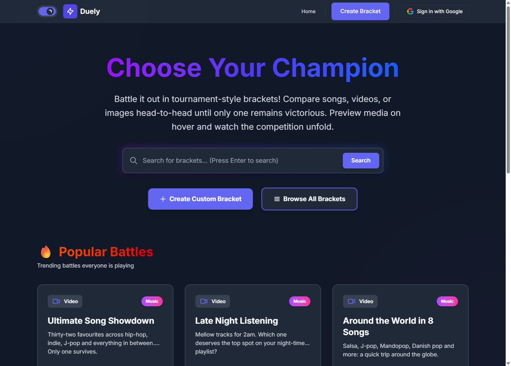
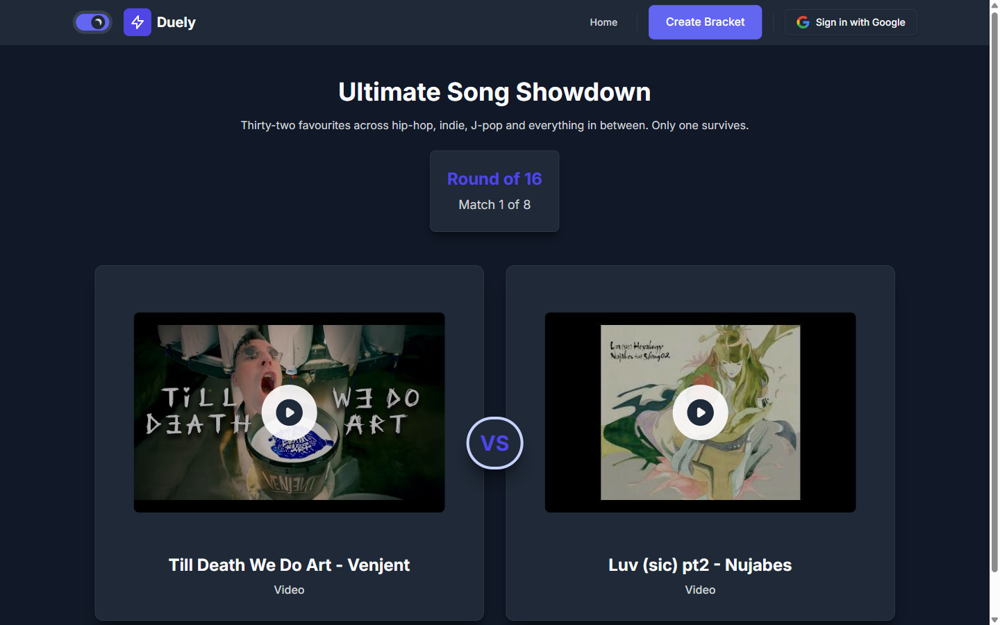
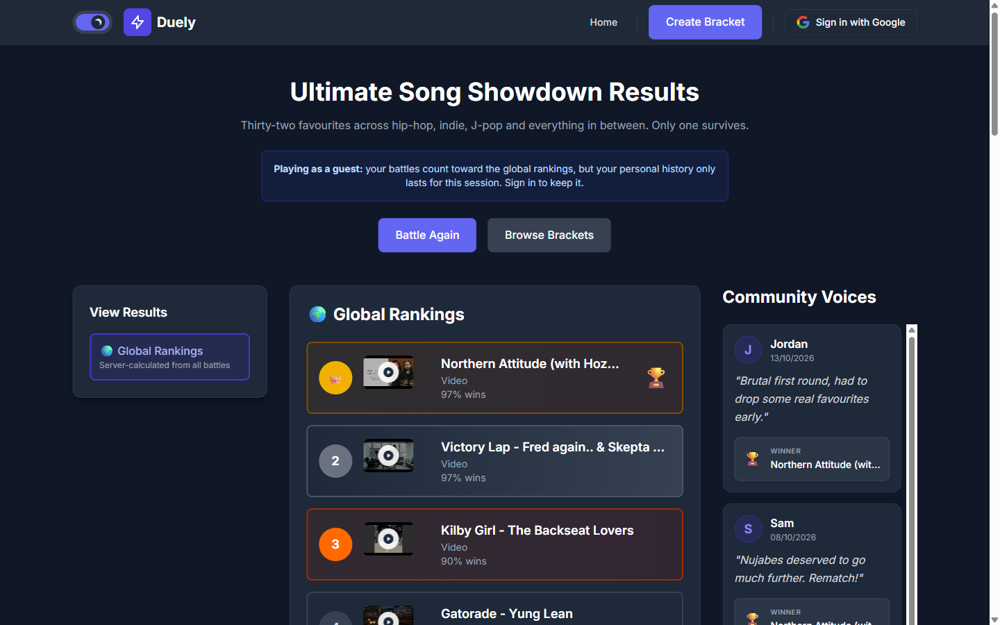
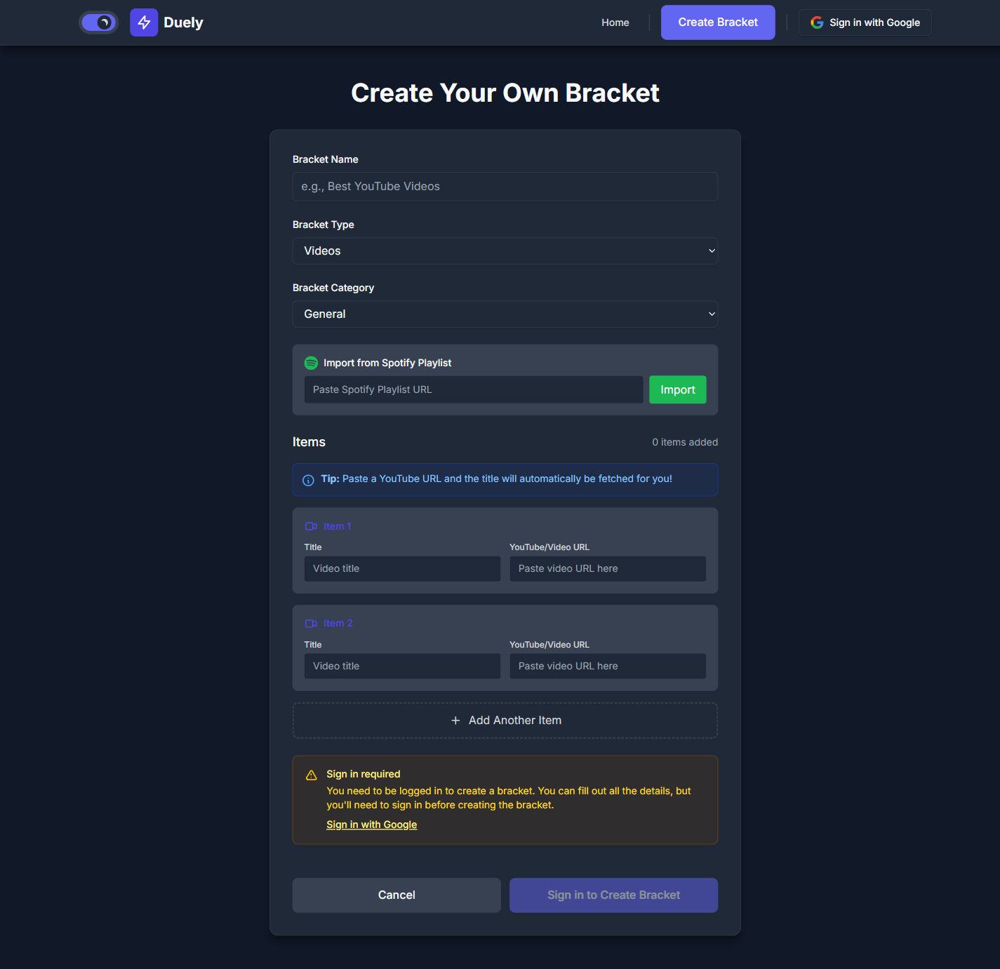

# Duely

**Tournament-style voting for songs, videos and images.** Pick a bracket, choose between two options at a time until one champion is left, then see how your picks compare with everyone else's.

[](https://github.com/haji5/duely/actions/workflows/docker-image.yml)


[](LICENSE)



<table>
  <tr>
    <td width="50%"></td>
    <td width="50%"></td>
  </tr>
  <tr>
    <td align="center"><b>Battle</b>: pick a winner, round by round</td>
    <td align="center"><b>Results</b>: server-calculated global rankings and comments</td>
  </tr>
</table>

<p align="center">
  <br>
  <b>Bracket builder</b>: paste links or import a whole Spotify playlist
</p>

---

## What it does

- **Head-to-head battles.** A bracket's items are shuffled into an elimination tournament. Choose a bracket size (a power of two): smaller sizes play a random subset, larger ones fill the spare slots with byes, and every bye is paired with a real entry so nobody skips more than one round.
- **Rich media.** Songs play inline, YouTube videos embed with thumbnails and Spotify tracks use Spotify's player. Image items show full-size previews.
- **Build your own brackets.** Paste YouTube or Spotify links and titles fill in automatically. You can also **import a whole Spotify playlist**, and each track is matched to an embeddable YouTube video. The form keeps a draft in the browser until the bracket is created, and a run in progress survives a reload.
- **Community rankings.** Every finished battle is saved. The results page shows your individual battles, your personal averages and the global leaderboard (normalised finishing position plus real head-to-head win rates), plus optional names and comments.
- **Guests welcome.** Anyone can play and submit results without an account; a guest's own runs are kept for the browser tab. Signing in with Google lets you create brackets and keeps your history across devices.
- **Moderation built in.** Anyone can report a bracket or a comment. Admins work through the reports at `/admin`: hide or delete a bracket, remove a comment or a whole run (the leaderboard is rebuilt without it). Owners can delete their own brackets, and any signed-in player can delete their data from the account menu.
- **Host it for friends, or for everyone.** One script serves the app to your local network or puts it on the internet through a Cloudflare quick tunnel. For a lasting public site, a production Compose file runs the published images on your own domain, behind a named Cloudflare tunnel or any hosting provider's load balancer, with nightly database backups.
- Light and dark themes, a responsive layout down to phone width, and keyboard-friendly battles.

## Engineering highlights

| Area | What's interesting |
| --- | --- |
| **Ranking engine** | The server runs the game's rules: it picks a run's entrants and signs them into a ticket (`POST /brackets/{id}/runs`), and when the run comes back it derives the ranking from the matches alone. Entries knocked out in the same round share a place and a score, `(n-1 - (a+b)/2)/(n-1)` for a tier on places a..b, so the champion scores 1 and all first-round losers score the same, and runs of different sizes stay on one scale. Each counted run updates an `item_stats` row per item in the same transaction as the result, so the leaderboard is one indexed query however many people have played. It sorts by the mean shrunk towards 0.5 by five imaginary runs, so one lucky run can't top a long record, and `StatsService` can rebuild it from the results at any time (on startup when the scoring version changes, and via the admin endpoint). |
| **Caching** | Spring Cache is backed by Valkey (a Redis-compatible store) with absolute per-cache TTLs. Each write evicts exactly the keys it changes: a counted run evicts that bracket's leaderboard and run count, its comments only if the run left one, and the player's history (an uncounted run only the history); hiding a bracket evicts it and the lists; deleting one evicts everything about it, including its players' histories. The list pages and the home page are the exception: they show run counts but are cached for two minutes rather than evicted on every run, so a busy site still serves them from the cache. If Valkey goes down, commands fail fast and requests are served from Postgres; the backend also starts without it. API responses are never cached by browsers (`Cache-Control: no-store`), so a result shows up immediately; the frontend keeps a small in-memory cache that writes invalidate explicitly. |
| **Lists at scale** | Every list is paged, filtered, sorted and searched in Postgres; nothing returns an unbounded list. Each bracket row carries its own counters (entries, counted runs, last counted run), set in the same transaction as the bracket or the run that changes them and recomputed by a rebuild, so sorting by popularity reads one partial index instead of counting runs per bracket. The home page is one cached request; comments come from their own partial index; your run history is the latest 100 runs of a bracket; and the sitemap turns into a sitemap index past 50,000 URLs. |
| **Auth & security** | A filter checks the Firebase ID token in the `Authorization: Bearer` header and maps custom claims to Spring Security roles. Browsers never attach that header to cross-site requests on their own, so there is no ambient credential for a CSRF attack to ride on and no CSRF token is needed. User text is stored exactly as typed (only normalised: Unicode NFC, newlines, control characters) and is always rendered as text, never as HTML. A bearer token that fails verification is a 401 on writes, so a signed-in run is never silently saved as a guest's. Media URLs must be public `https` links whose host resolves to public addresses when the bracket is created (hygiene, not a security boundary: a host can point elsewhere later), with at most 20 different hosts per bracket and a bounded time for all lookups; viewers load images without a referrer. Brackets, entries and runs leave the server as view classes, never entities, so a new column is private until a view names it. Cache deserialization only accepts known classes, and nginx sends a strict content security policy. |
| **Abuse protection** | Fixed-window rate limits live in Valkey (an atomic `INCR`/`EXPIRE` script), so they are shared by every backend instance and their memory is bounded. Reads are limited per client address, run starts, result submissions and reports per user (or per address for guests), bracket creation and metadata lookups per user; a 429 carries `Retry-After`. An address means an IPv4 address or an IPv6 /64, since one IPv6 connection can rotate through a whole /64. If Valkey is unreachable, reads go unlimited while every other limit keeps counting in memory on each backend instance, so a Valkey restart never lifts the write limits. What one player can add to a leaderboard is bounded separately: per bracket and day only 10 runs per signed-in user and 30 per guest address are counted, and a run faster than the UI allows (0.4 s per match) isn't counted either. Such runs are still saved and shown to their player; the response doesn't say. Duplicate submissions (double clicks, retries) are idempotent on the ticket. |
| **Data integrity** | Liquibase owns the schema and Hibernate only validates it. A bracket and all its entries are created in one transaction. A run is only accepted with a ticket the server signed (HMAC-SHA256, at most 12 hours old, for this bracket), whose matches name exactly the entrants it was issued for and form one single-elimination tournament: n-1 matches, every entry but the champion loses exactly once, no pair meets twice, no cycles, and nobody goes out deeper than the bracket has rounds. Deleting a bracket cascades to its entries, runs and leaderboard rows in the database; deleting a run rebuilds its bracket's leaderboard in the same transaction. A hidden bracket is a 404 on every public route, page and the sitemap, for everyone but its owner and admins (ownership is read from the table, never the cache). |
| **Upstream lookups** | Playlist imports and YouTube matching scrape Spotify's embed page and YouTube's search page, so they depend on those pages' markup and break when it changes (they fail with a 502, counted in the metrics, until the parsing is updated). The official YouTube search API isn't an option: its default quota can't serve a single playlist import. At most four lookups run at once per backend instance, a breaker pauses an upstream for a minute after five failures in a row, matches are cached for a day and "no match" for an hour, and a video whose embed check failed is never offered. Requests run on virtual threads, so waiting on an upstream holds no platform thread. |
| **Operations** | Actuator listens on its own port (8081), which nginx never proxies and Compose never publishes: health checks, and Prometheus metrics at `/actuator/prometheus` for a scraper on the Docker network, with counters for rate-limit rejections per bucket, uncounted runs per reason, and scrape failures. nginx logs each request with its total and upstream time. |
| **Delivery** | Multi-stage Docker builds run as non-root users, with health-gated startup and restart policies in Compose. nginx serves the single-page app and proxies `/api`. GitHub Actions runs the backend and frontend test suites and ESLint, then builds both images and publishes them to GitHub Container Registry; the production Compose file runs those images at a pinned tag. Dependabot proposes weekly updates for Maven, npm, the base images, the Compose images and the actions, and nginx is pinned to an exact version. The same images serve any domain behind any proxy: nginx writes the trusted proxy addresses and the public origin into its config at start. The public origin is configured, never taken from the request, and the backend refuses to start in production unless it is public `https`, so canonicals, the sitemap, `robots.txt` and shared links always name the real site. |

## Architecture


The backend's routes have no `/api` prefix. nginx in Docker and the Vite dev server locally both strip it before forwarding requests.

## Tech stack

| Layer | Technologies |
| --- | --- |
| Frontend | React 19, TypeScript, Vite 7, Tailwind CSS 4, Framer Motion, React Router 7, Axios, Firebase JS SDK, Vitest |
| Backend | Java 21, Spring Boot 4.1 (Web MVC, Security, Data JPA, Data Redis, Validation, Cache, Actuator), Firebase Admin SDK, Jsoup, JUnit 5, Testcontainers |
| Data | PostgreSQL 15, Liquibase, Valkey 8 |
| Infrastructure | Docker, Docker Compose, nginx, Cloudflare Tunnel, GitHub Actions, GitHub Container Registry |

## Getting started

### Prerequisites

- [Docker Desktop](https://www.docker.com/products/docker-desktop/) (or Docker Engine with Compose)
- A [Firebase](https://console.firebase.google.com) project with **Google** sign-in enabled
- For running without Docker: Node.js 22 (see `frontend/.nvmrc`), JDK 21 and Maven 3.9

### 1. Configure Firebase

1. In the Firebase Console, add a **Web app** and copy its config values.
2. Under **Project settings → Service accounts**, click **Generate new private key** and download the JSON file.

### 2. Create the environment files

```bash
cp .env.example .env
cp backend/.env.example backend/.env
```

- In `.env`, fill in the `VITE_FIREBASE_*` values and pick a database password.
- In `backend/.env`, set `FIREBASE_CREDENTIALS_JSON` to the service-account JSON, base64-encoded (Compose env files can't hold multi-line values, so raw JSON only works squeezed onto one line). On Windows:

  ```powershell
  [Convert]::ToBase64String([IO.File]::ReadAllBytes("C:\path\to\serviceAccountKey.json")) | Set-Clipboard
  ```

### 3. Run with Docker Compose

```bash
docker compose up --build
```

| Service | URL |
| --- | --- |
| App | http://localhost:3000 |
| API (through nginx) | http://localhost:3000/api/brackets |
| Backend health | `docker compose ps`, or `docker compose exec backend wget -qO- localhost:8081/actuator/health` |
| Metrics | `docker compose exec backend wget -qO- localhost:8081/actuator/prometheus` |

Postgres, Valkey and the backend are bound to `127.0.0.1` only (set `BACKEND_HOST_PORT` to publish the backend elsewhere; inside Docker it always listens on 8080). The backend's management port, 8081, isn't published at all. Other devices reach the app through nginx on port 3000. The backend waits for Postgres and Valkey to be healthy, and the frontend waits for the backend.

### Share it with friends (Windows)

```powershell
.\host.ps1 start            # same Wi-Fi: prints http://<your-lan-ip>:3000
.\host.ps1 start -Internet  # public HTTPS URL through a Cloudflare quick tunnel
.\host.ps1 status
.\host.ps1 stop
```

The script finds the LAN IP of the adapter holding your default route, starts the stack and waits until it's healthy. In LAN mode it also opens port 3000 in Windows Firewall for private networks (when run as Administrator). In Internet mode no firewall change is needed; nginx passes the tunnel's `https` scheme to the backend, so requests through the tunnel are same-origin. For Google sign-in on the tunnel URL, add its host name under **Firebase Console → Authentication → Settings → Authorized domains** (raw LAN IPs generally can't be authorized). Guests can play without signing in either way.

The quick tunnel is for an evening with friends or a demo: its `trycloudflare.com` address changes on every start (so shared links die and the Firebase entry has to be added again), Cloudflare gives it no uptime guarantee, and canonicals and the sitemap still say `localhost`. For a site people can bookmark, see [Running it publicly](#running-it-publicly).

Under Docker Desktop every LAN device reaches nginx through the same gateway address, so LAN guests share one per-IP rate-limit bucket; the guest limits are sized for that.

### Local development without Docker

Start PostgreSQL (database `bracket_battle`) and Valkey or Redis on their default ports. The easiest way is to run only those containers:

```bash
docker compose up postgres valkey
```

**Backend** (Spring Boot doesn't read `.env` files, so export the variables from `backend/.env.example`):

```bash
cd backend
export DB_PASSWORD=change_me FIREBASE_CREDENTIALS_JSON="$(base64 -w0 /path/to/serviceAccountKey.json)"
mvn spring-boot:run
```

**Frontend** (the Vite dev server proxies `/api` to `localhost:8080`):

```bash
cd frontend
cp .env.example .env.local   # fill in the VITE_FIREBASE_* values
npm install
npm run dev                  # http://localhost:3000
```

## Running it publicly

`docker-compose.prod.yml` runs the images CI publishes to GitHub Container Registry, at a tag you choose, with nightly backups. It serves plain HTTP on port 3000 and expects a proxy in front that terminates TLS. Today that's a named Cloudflare tunnel (`docker-compose.tunnel.yml`, an overlay on top); on a hosting provider, its load balancer takes the tunnel's place and nothing else changes.

### What it needs

Set these in `.env` (the secrets in `.env` and `backend/.env` stay as for development):

- `PUBLIC_BASE_URL`: the public origin, e.g. `https://duely.example`. It goes into canonicals, link previews, JSON-LD, the sitemap and `robots.txt`, and the app hands out share links on it, wherever the page was opened from. The backend refuses to start unless it is `https` on a public host (`localhost`, loopback and private addresses are rejected).
- `DUELY_TAG`: the image tag to run. Pushing a git tag `v1.2.0` publishes `1.2.0` and `1.2`; every push to `master` publishes the commit's short sha and `master`. The frontend image has the Firebase web config built in from the repository's `VITE_FIREBASE_*` Actions secrets, so set those before the first release. While the packages are private, sign in once with `docker login ghcr.io` and a token that can read packages, or make the two packages public.
- `RUN_TICKET_SECRET` in `backend/.env`, so runs in progress survive a restart.
- Under **Firebase Console → Authentication → Settings → Authorized domains**, the domain, once.
- Recommended, `FIREBASE_AUTH_PROXY`: the project's auth host, e.g. `duely-12345.firebaseapp.com`. Where the sign-in popup can't open (in-app browsers such as Instagram's or TikTok's, where shared links usually open), Duely signs in by redirect instead, and in browsers that block third-party storage (Safari, and every iOS in-app browser) that only works when the sign-in pages are on the site's own domain. With this set, nginx serves them at `/__/auth/` and the app uses the site's host as its auth domain. Add `https://duely.example/__/auth/handler` to the **Authorized redirect URIs** of the project's OAuth web client in the Google Cloud console (**APIs & Services → Credentials**).
- `TRUSTED_PROXIES`: the address the proxy connects from, so rate limits see each visitor's address (below). The tunnel overlay sets it for you.

### With a Cloudflare tunnel

1. Add the domain to Cloudflare. In the Zero Trust dashboard (**Networks → Tunnels**), create a cloudflared tunnel, copy its token, and give it a public hostname (e.g. `duely.example`) whose service is `http://frontend:3000`.
2. In `.env`: `PUBLIC_BASE_URL=https://duely.example`, `CLOUDFLARE_TUNNEL_TOKEN=<token>`, `DUELY_TAG=<tag>`.
3. Start it:

   ```bash
   docker compose -f docker-compose.prod.yml -f docker-compose.tunnel.yml up -d
   ```

cloudflared connects outwards, so no port is opened to the Internet. The overlay pins it to `172.29.53.250` and makes that the only trusted proxy; nginx takes the visitor's address from the end of `X-Forwarded-For`, the entry Cloudflare appended. Add the overlay's `-f` to every other command below too.

### On a hosting provider

Leave the tunnel overlay out and point the provider's TLS-terminating load balancer (or a reverse proxy such as Caddy) at port 3000:

- `HTTP_BIND=0.0.0.0` when the proxy runs on another machine, with the port firewalled to it. A proxy on the same host can use the default, `127.0.0.1`.
- `TRUSTED_PROXIES`: the addresses the proxy connects from, comma-separated, CIDRs allowed: the load balancer's private range (e.g. `10.0.0.0/16`), or `172.29.53.1`, the Docker network's gateway, for a proxy on the same host. Left empty, every visitor appears as the proxy and they all share its rate limits.
- `REAL_IP_HEADER` if the proxy reports the visitor somewhere other than at the end of `X-Forwarded-For` (e.g. `CF-Connecting-IP` behind Cloudflare's proxy, `Fly-Client-IP` on Fly.io).
- The proxy must send `X-Forwarded-Proto: https` (load balancers do), so the backend knows requests arrived over https.

### Metrics and logs

Prometheus metrics are at `http://backend:8081/actuator/prometheus` for any container on `bracket-battle-network`; add a Prometheus (or Grafana Agent) service there with an override file. Nothing outside the Docker network reaches the port. Duely's own counters are `duely_rate_limit_rejections_total{bucket}`, `duely_runs_uncounted_total{reason}` (`too_fast`, `quota`), `duely_scrape_failures_total{upstream}` and `duely_scrape_rejected_total{upstream,reason}` (`busy`, `paused`), next to Spring's request timings (`http_server_requests_seconds`), the connection pool and the JVM. `docker compose logs frontend` shows nginx's access log: `rt=` is the whole request in seconds, `urt=` the backend's share.

### Backups

The `backup` service writes `pg_dump -Fc` dumps to `BACKUP_DIR` (default `./backups`): at start if the newest is more than a day old, then daily at `BACKUP_TIME` (default `03:30`, in `TZ`, default UTC). Dumps older than `BACKUP_KEEP_DAYS` (14) are deleted. To dump now, before an update say:

```bash
docker compose -f docker-compose.prod.yml exec backup sh /backup.sh now
```

The dumps sit on the same disk as the database, so keep a copy elsewhere: sync the directory from the host (rclone, restic, a cloud drive's folder), or set `BACKUP_HOOK` to a script you mount into the container with an override file; it runs after every dump with the dump's path as its argument.

### Restoring

A restore replaces the database with a dump. It refuses while the backend is connected, and first saves the current database as `pre-restore-<time>.dump`, which is never deleted automatically.

```bash
docker compose -f docker-compose.prod.yml stop backend
docker compose -f docker-compose.prod.yml run --rm backup restore duely-20261111-033000.dump
docker compose -f docker-compose.prod.yml start backend
```

On a new machine, copy the dump into `backups/`, start Postgres alone (`docker compose -f docker-compose.prod.yml up -d postgres`), restore, then `up -d`. On start the backend applies whatever migrations are newer than the dump.

### Updating

Take a dump, set `DUELY_TAG` to the new tag, then:

```bash
docker compose -f docker-compose.prod.yml pull
docker compose -f docker-compose.prod.yml up -d
```

The backend migrates the database on start. To go back, set the old tag again; if the new version had migrated the schema, restore the dump you took first.

### From the development stack

The production file uses the same Compose project (`duely`), network and database volume as `docker-compose.yml` in a checkout named `duely`, so stopping one (`.\host.ps1 stop` or `docker compose down`, never with `-v`) and starting the other keeps your brackets. Run one at a time. Valkey keeps nothing on disk in either; the old `duely_valkey_data` volume is unused and `docker volume rm duely_valkey_data` removes it.

## Configuration

| Variable | Where | Purpose |
| --- | --- | --- |
| `DB_URL`, `DB_USERNAME`, `DB_PASSWORD` | `.env` | PostgreSQL connection |
| `VALKEY_HOST`, `VALKEY_PORT`, `VALKEY_PASSWORD` | backend env | Cache connection (default `localhost:6379`) |
| `CORS_ALLOWED_ORIGINS` | `.env` | Comma-separated origins allowed to call the API cross-origin (pages served by nginx are same-origin and need no entry) |
| `BACKEND_HOST_PORT` | `.env` | Host port for the backend on `127.0.0.1` (default 8080) |
| `FIREBASE_CREDENTIALS_JSON` / `GOOGLE_APPLICATION_CREDENTIALS` | `backend/.env` | Firebase Admin service account (JSON, base64 JSON, or a file path) |
| `VITE_FIREBASE_*` | `.env` / `frontend/.env.local` | Firebase web app config, built into the frontend bundle |
| `VITE_API_URL` | frontend | API base URL (default `/api`) |
| `RUN_TICKET_SECRET` | `backend/.env` | HMAC secret for run tickets, at least 32 bytes. Without it each start makes a random one (runs in progress can't be saved after a restart, and several instances would reject each other's tickets). |
| `READ_RATE_LIMIT`, `RESULT_USER_RATE_LIMIT`, `RESULT_IP_RATE_LIMIT`, `RUN_START_USER_RATE_LIMIT`, `RUN_START_IP_RATE_LIMIT`, `BRACKET_CREATION_LIMIT`, `METADATA_SEARCH_LIMIT`, `METADATA_PLAYLIST_LIMIT` | backend env | Rate limits. Defaults: 600 reads/min per address, 5 runs/min per user and 20/min per guest address, 30 run starts/min per user and 60 per guest address, 10 brackets/hour, 600 YouTube searches and 30 playlist imports per hour per user. Any `app.rate-limit.buckets.*` property can be overridden. |
| `COUNTED_RUNS_PER_USER`, `COUNTED_RUNS_PER_IP` | backend env | Runs per bracket and day that count toward its leaderboard (defaults 10 per user, 30 per guest address); later runs are saved but not counted. |
| `REPORT_RATE_LIMIT` | backend env | Reports per hour per user or guest address (default 5). |
| `PUBLIC_BASE_URL` | `.env` | The public origin for canonicals, link previews, JSON-LD, the sitemap, `robots.txt` and share links. Required by `docker-compose.prod.yml`, which also sets `REQUIRE_PUBLIC_ORIGIN=true` (refuse to start unless it is public `https`). Development defaults to `http://localhost:3000`, and share links then use the page's own host. |
| `TRUSTED_PROXIES`, `REAL_IP_HEADER` | `.env` | Addresses or CIDRs (comma-separated) allowed to report the client address to nginx, and the header they use (default `X-Forwarded-For`, last entry). Development trusts the quick tunnel's `172.29.53.250`; see [On a hosting provider](#on-a-hosting-provider). |
| `DUELY_TAG`, `IMAGE_REPOSITORY` | `.env` | Production: the image tag to run, and the GHCR repository (default `haji5/duely`). |
| `HTTP_BIND`, `HTTP_PORT` | `.env` | Production: where nginx is published on the host (default `127.0.0.1:3000`). |
| `CLOUDFLARE_TUNNEL_TOKEN` | `.env` | The named tunnel's token, for `docker-compose.tunnel.yml`. |
| `FIREBASE_AUTH_PROXY` | `.env` | The Firebase project's auth host (`<project>.firebaseapp.com`). Set, nginx serves its sign-in pages at `/__/auth/` and the app signs in on its own domain; needs `PUBLIC_BASE_URL`. See [What it needs](#what-it-needs). |
| `MANAGEMENT_PORT` | backend env | Actuator's port (default 8081; Compose pins it). |
| `BACKUP_DIR`, `BACKUP_TIME`, `TZ`, `BACKUP_KEEP_DAYS`, `BACKUP_HOOK` | `.env` | Production backups: where dumps go (`./backups`), when (`03:30` UTC), for how long (14 days), and a script to run after each one. |

Grant admin access by setting a Firebase custom claim of `{"admin": true}` or `{"role": "ADMIN"}` on a user. Admins see a **Reports** entry in the account menu, which opens the moderation queue at `/admin`.

## API reference

All routes are served under `/api` by the proxy.

| Method | Route | Auth | Description |
| --- | --- | --- | --- |
| GET | `/brackets?sort=&type=&category=&q=&page=&size=` | – | A page of the playable brackets (2+ entries; hidden ones left out): `{items, page, size, total}`. `sort` is `newest` (default), `oldest`, `popular` (most counted runs) or `name`; `q` matches name or description, ignoring case; `page` starts at 0; `size` defaults to 24 and is capped at 50. Each bracket carries `itemCount` and `runCount` |
| GET | `/home` | – | The home page's lists in one response: `popular` and `recent` (6 each) and the top 3 of each category |
| GET | `/brackets/{id}` | – | One bracket. A hidden bracket (`hiddenAt` set) is a 404 here and on every `/brackets/{id}/…` route except for its owner and admins |
| DELETE | `/brackets/{id}` | owner or admin | Delete a bracket with its entries, runs and leaderboard |
| GET | `/brackets/{id}/items` | – | Entries in a bracket |
| GET | `/brackets/{id}/rankings` | – | Global leaderboard |
| GET | `/brackets/{id}/comments` | – | Newest 50 comments (no user ids) |
| POST | `/brackets/{id}/runs` | optional | Start a run: `{size}` gives `{ticket, entrantIds, size}`, the entrants in seeding order |
| POST | `/brackets/{id}/results` | optional | Submit a run: `{ticket, matches, displayName?, comment?}`, matches in the order played. Returns the run with the server-derived `ranking` and tied `places`. Idempotent per ticket (409 if it belongs to someone else) |
| POST | `/brackets` | user | Create a bracket together with its 2–500 entries |
| GET | `/me/brackets` | user | A page of the brackets you created, hidden and unplayable ones included; the same parameters as `/brackets` |
| GET | `/me/results?bracketId=` | user | Your latest 100 runs of a bracket, oldest first (`bracketId` is required) |
| DELETE | `/me` | user | Delete your data: brackets nobody else has played go; the rest lose their owner; your runs stay in the rankings anonymously, without names or comments |
| POST | `/reports` | optional | Report `{targetType, targetId, reason, details?}`: a `bracket` id, or for a `comment` the id from `/comments`. Reasons are in `shared/report-reasons.json` |
| GET | `/metadata/spotify/playlist?url=` | user | Tracks from a public Spotify playlist |
| GET | `/metadata/youtube/search?query=` | user | First embeddable YouTube match, or 404 when none of the top results can be embedded. Lookups are a 503 while four are running already or the upstream is paused after failures, and a 502 when it fails |
| POST | `/admin/cache/clear[/{name}]` | admin | Clear all caches or one |
| POST | `/admin/brackets/{id}/stats/rebuild` | admin | Recompute a bracket's leaderboard and run count from its counted runs |
| POST | `/admin/brackets/{id}/hide`, `/unhide` | admin | Take a bracket off every public list and page, or put it back |
| DELETE | `/admin/results/{id}/comment` | admin | Clear a run's comment and display name; the run still counts |
| DELETE | `/admin/results/{id}` | admin | Delete a run and rebuild its bracket's leaderboard |
| GET | `/admin/reports?open=` | admin | The newest 200 reports (open ones only unless `open=false`), with what each is about |
| POST | `/admin/reports/{id}/resolve` | admin | Close a report without acting on it. Hiding, deleting and clearing resolve the reports about their target |
| GET | `/actuator/health`, `/actuator/info`, `/actuator/prometheus` | – | Health and metrics, on the management port 8081 only (inside the Docker network) |

Errors are JSON: `{timestamp, status, error, message, errors?}`, where `errors` maps fields such as `items[2].mediaUrl` to messages.

## Project structure

```
duely/
├── backend/                         Spring Boot API
│   └── src/main/
│       ├── java/com/bracketbattle/
│       │   ├── controller/          REST endpoints (brackets, reports, metadata, admin)
│       │   ├── service/             Bracket creation, runs, stats rebuilds, visibility, moderation, account deletion
│       │   ├── scoring/             Pure run scoring, leaderboard order, bracket sizes
│       │   ├── security/            Firebase token filter, security config
│       │   ├── ratelimit/           Valkey fixed-window rate limiter, client subjects
│       │   ├── media/               Media URL validation, YouTube/Spotify metadata
│       │   ├── config/              Cache and web config
│       │   ├── model/ dto/ repository/   (item_stats aggregates in ItemStatsRepository)
│       │   └── util/Sanitizer.java  plain-text normalisation of user input
│       └── resources/
│           ├── application.properties
│           └── db/changelog/        Liquibase migrations
├── frontend/                        React single-page app
│   ├── src/
│   │   ├── pages/                   Home, Browse, Bracket (battle), Results, Create, About, Privacy, Admin (reports)
│   │   ├── components/              Media preview, navbar, auth widgets
│   │   ├── contexts/                Auth, theme, guest session battles
│   │   ├── services/                Axios client, oEmbed title lookups
│   │   └── utils/                   Tournament engine, rankings, API cache, media URL helpers, saved runs and drafts
│   ├── nginx.conf                   Production server and /api proxy
│   ├── runtime-config.sh            Writes the trusted proxies, public origin and sign-in proxy into nginx's config at start
│   └── security-headers.conf        Headers shared by every nginx location
├── deploy/backup.sh                 Nightly dumps, retention and restore for the backup service
├── docs/screenshots/                README images
├── .github/workflows/               CI: tests and lint, then build and publish Docker images
├── .github/dependabot.yml           Weekly dependency updates
├── docker-compose.yml               Full stack, built from source
├── docker-compose.local.yml         LAN / quick-tunnel overlay used by host.ps1
├── docker-compose.prod.yml          Public deployment from published images, with backups
├── docker-compose.tunnel.yml        Named Cloudflare tunnel overlay for the public deployment
└── host.ps1                         One-command hosting script
```

## Testing

```bash
cd backend && mvn verify      # unit tests, then integration tests (needs Docker running)
cd frontend && npm run typecheck && npm run lint && npm test && npm run build
```

- **Backend:** JUnit 5 unit tests (media URL validation, sanitizer, run scoring, leaderboard order, run tickets, rate-limit windows) run in `mvn test`. Integration tests (`*IT`) start Postgres and Valkey with Testcontainers and drive the API through MockMvc with a mocked `FirebaseAuth`: creation, run tickets, submissions and idempotency, uncounted runs, rankings after several runs, stats rebuilds, comments, paged, filtered and searched lists over a few hundred brackets in every order, the home lists, the counters on each bracket and what each run evicts, the sitemap index, `robots.txt` and pages that name only the configured origin, `/me` endpoints, moderation (hiding and deleting brackets, deleting runs, clearing comments, reports, account deletion) as guest, other user, owner and admin, error statuses, admin access, rate limits with `Retry-After`, the metrics, the exact fields each response carries, playlist and YouTube lookups against fake upstream pages (no-match caching, failed embed checks), the host cap, cache round-trips through real Valkey, the Liquibase backfills and schema checks, and startup with Valkey down. Unit tests cover the upstream guard's concurrency limit and breaker, and the DNS budget.
- **Shared vectors:** where the frontend mirrors a backend rule (run scoring, leaderboard order, bracket sizes, categories, report reasons, media hosts per bracket), the cases live once in `shared/*.json` and both suites check them.
- **Frontend:** Vitest covers the tournament engine (every entry count from 2 to 20 at every size, each checked against the server's run validation), the ranking formula, media URL rules, Browse driving the server's filters, search and pages from the URL, the home page's lists, the bracket builder's title autofill and draft, resuming a run, the privacy page, and the redirect sign-in fallback.
- **Lint:** ESLint with type-aware typescript-eslint rules, the React hooks rules and jsx-a11y; CI allows no warnings.
- CI runs both suites, the lint and `npm audit --omit=dev` before any image is built.

`frontend/package.json` overrides `@grpc/grpc-js`: Firebase's Firestore package still pins a vulnerable 1.9.x release. Duely doesn't use Firestore (and gRPC never runs in the browser), so the override only keeps `npm audit` clean.

## Roadmap

- Bracket editing for owners
- Copying images into storage Duely owns when a bracket is created, instead of hotlinking them. Not an image proxy on this server: that would make the URL check a real SSRF boundary.

## License

© Tobias Richardson. Licensed under the [PolyForm Noncommercial License 1.0.0](LICENSE).

You're free to use, modify and share this code for personal projects, study, research, hobby use and other noncommercial purposes. Commercial use, including selling the code or a product or service built on it, isn't permitted. For a commercial license, [get in touch](https://github.com/haji5).
