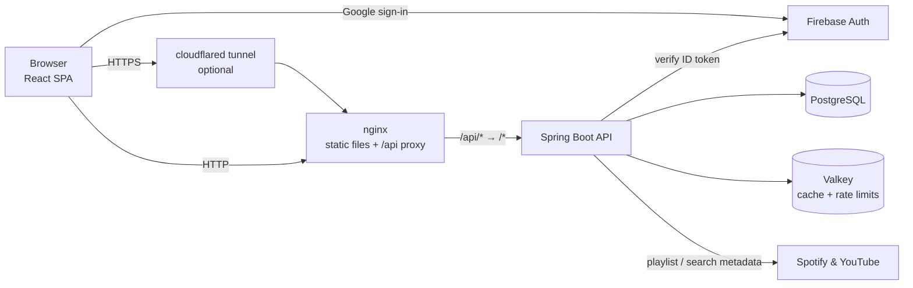

# Duely

**Tournament-style voting for songs, videos and images.** Pick a bracket, choose between two options at a time until one champion is left, then see how your picks compare with everyone else's.

[](https://github.com/haji5/duely/actions/workflows/docker-image.yml)


[](LICENSE)


<table>
  <tr>
    <td width="50%"></td>
    <td width="50%"></td>
  </tr>
  <tr>
    <td align="center"><b>Battle</b>: pick a winner, round by round</td>
    <td align="center"><b>Results</b>: server-calculated global rankings and comments</td>
  </tr>
</table>

<p align="center">
  <br>
  <b>Bracket builder</b>: paste links or import a whole Spotify playlist
</p>

---

## What it does

- **Head-to-head battles.** A bracket's items are shuffled into an elimination tournament. Choose a bracket size (a power of two): smaller sizes play a random subset, larger ones fill the spare slots with byes, and every bye is paired with a real entry so nobody skips more than one round.
- **Rich media.** Songs play inline, YouTube videos embed with thumbnails and Spotify tracks use Spotify's player. Image items show full-size previews.
- **Build your own brackets.** Paste YouTube or Spotify links and titles fill in automatically. You can also **import a whole Spotify playlist**, and each track is matched to an embeddable YouTube video.
- **Community rankings.** Every finished battle is saved. The results page shows your individual battles, your personal averages and the global leaderboard (normalised finishing position plus real head-to-head win rates), plus optional names and comments.
- **Guests welcome.** Anyone can play and submit results without an account; a guest's own runs are kept for the browser tab. Signing in with Google lets you create brackets and keeps your history across devices.
- **Moderation built in.** Anyone can report a bracket or a comment. Admins work through the reports at `/admin`: hide or delete a bracket, remove a comment or a whole run (the leaderboard is rebuilt without it). Owners can delete their own brackets, and any signed-in player can delete their data from the account menu.
- **Host it for friends.** One script serves the app to your local network or puts it on the internet through a Cloudflare tunnel.
- Light and dark themes, a responsive layout down to phone width, and keyboard-friendly battles.

## Engineering highlights

| Area | What's interesting |
| --- | --- |
| **Ranking engine** | The server runs the game's rules: it picks a run's entrants and signs them into a ticket (`POST /brackets/{id}/runs`), and when the run comes back it derives the ranking from the matches alone. Entries knocked out in the same round share a place and a score, `(n-1 - (a+b)/2)/(n-1)` for a tier on places a..b, so the champion scores 1 and all first-round losers score the same, and runs of different sizes stay on one scale. Each counted run updates an `item_stats` row per item in the same transaction as the result, so the leaderboard is one indexed query however many people have played. It sorts by the mean shrunk towards 0.5 by five imaginary runs, so one lucky run can't top a long record, and `StatsService` can rebuild it from the results at any time (on startup when the scoring version changes, and via the admin endpoint). |
| **Caching** | Spring Cache is backed by Valkey (a Redis-compatible store) with absolute per-cache TTLs. Each write evicts exactly the keys it changes (a run evicts that bracket's rankings and comments and the player's history; hiding a bracket evicts it and the lists; deleting one evicts everything about it, including its players' histories). If Valkey goes down, commands fail fast and requests are served from Postgres; the backend also starts without it. API responses are never cached by browsers (`Cache-Control: no-store`), so a result shows up immediately; the frontend keeps a small in-memory cache that writes invalidate explicitly. |
| **Auth & security** | A filter checks the Firebase ID token in the `Authorization: Bearer` header and maps custom claims to Spring Security roles. Browsers never attach that header to cross-site requests on their own, so there is no ambient credential for a CSRF attack to ride on and no CSRF token is needed. User text is stored exactly as typed (only normalised: Unicode NFC, newlines, control characters) and is always rendered as text, never as HTML. A bearer token that fails verification is a 401 on writes, so a signed-in run is never silently saved as a guest's. Media URLs must be public `https` links (private, loopback, link-local and cloud-metadata addresses are rejected after DNS resolution), cache deserialization only accepts known classes, and nginx sends a strict content security policy. |
| **Abuse protection** | Fixed-window rate limits live in Valkey (an atomic `INCR`/`EXPIRE` script), so they are shared by every backend instance and their memory is bounded. Reads are limited per client address, run starts, result submissions and reports per user (or per address for guests), bracket creation and metadata lookups per user; a 429 carries `Retry-After`. An address means an IPv4 address or an IPv6 /64, since one IPv6 connection can rotate through a whole /64. If Valkey is unreachable, reads go unlimited while every other limit keeps counting in memory on each backend instance, so a Valkey restart never lifts the write limits. What one player can add to a leaderboard is bounded separately: per bracket and day only 10 runs per signed-in user and 30 per guest address are counted, and a run faster than the UI allows (0.4 s per match) isn't counted either. Such runs are still saved and shown to their player; the response doesn't say. Duplicate submissions (double clicks, retries) are idempotent on the ticket. |
| **Data integrity** | Liquibase owns the schema and Hibernate only validates it. A bracket and all its entries are created in one transaction. A run is only accepted with a ticket the server signed (HMAC-SHA256, at most 12 hours old, for this bracket), whose matches name exactly the entrants it was issued for and form one single-elimination tournament: n-1 matches, every entry but the champion loses exactly once, no pair meets twice, no cycles, and nobody goes out deeper than the bracket has rounds. Deleting a bracket cascades to its entries, runs and leaderboard rows in the database; deleting a run rebuilds its bracket's leaderboard in the same transaction. A hidden bracket is a 404 on every public route, page and the sitemap, for everyone but its owner and admins (ownership is read from the table, never the cache). |
| **Delivery** | Multi-stage Docker builds run as non-root users, with health-gated startup and restart policies in Compose. nginx serves the single-page app and proxies `/api`. GitHub Actions runs the backend and frontend test suites, then builds both images and publishes them to GitHub Container Registry. |

## Architecture



The backend's routes have no `/api` prefix. nginx in Docker and the Vite dev server locally both strip it before forwarding requests.

## Tech stack

| Layer | Technologies |
| --- | --- |
| Frontend | React 19, TypeScript, Vite 7, Tailwind CSS 4, Framer Motion, React Router 7, Axios, Firebase JS SDK, Vitest |
| Backend | Java 21, Spring Boot 4.1 (Web MVC, Security, Data JPA, Data Redis, Validation, Cache, Actuator), Firebase Admin SDK, Jsoup, JUnit 5, Testcontainers |
| Data | PostgreSQL 15, Liquibase, Valkey 8 |
| Infrastructure | Docker, Docker Compose, nginx, Cloudflare Tunnel, GitHub Actions, GitHub Container Registry |

## Getting started

### Prerequisites

- [Docker Desktop](https://www.docker.com/products/docker-desktop/) (or Docker Engine with Compose)
- A [Firebase](https://console.firebase.google.com) project with **Google** sign-in enabled
- For running without Docker: Node.js 22 (see `frontend/.nvmrc`), JDK 21 and Maven 3.9

### 1. Configure Firebase

1. In the Firebase Console, add a **Web app** and copy its config values.
2. Under **Project settings → Service accounts**, click **Generate new private key** and download the JSON file.

### 2. Create the environment files

```bash
cp .env.example .env
cp backend/.env.example backend/.env
```

- In `.env`, fill in the `VITE_FIREBASE_*` values and pick a database password.
- In `backend/.env`, set `FIREBASE_CREDENTIALS_JSON` to the service-account JSON, base64-encoded (Compose env files can't hold multi-line values, so raw JSON only works squeezed onto one line). On Windows:

  ```powershell
  [Convert]::ToBase64String([IO.File]::ReadAllBytes("C:\path\to\serviceAccountKey.json")) | Set-Clipboard
  ```

### 3. Run with Docker Compose

```bash
docker compose up --build
```

| Service | URL |
| --- | --- |
| App | http://localhost:3000 |
| API (through nginx) | http://localhost:3000/api/brackets |
| Backend health | http://localhost:8080/actuator/health (readiness: `/actuator/health/readiness`) |

Postgres, Valkey and the backend are bound to `127.0.0.1` only (set `BACKEND_HOST_PORT` to publish the backend elsewhere; inside Docker it always listens on 8080). Other devices reach the app through nginx on port 3000. The backend waits for Postgres and Valkey to be healthy, and the frontend waits for the backend.

### Share it with friends (Windows)

```powershell
.\host.ps1 start            # same Wi-Fi: prints http://<your-lan-ip>:3000
.\host.ps1 start -Internet  # public HTTPS URL through a Cloudflare quick tunnel
.\host.ps1 status
.\host.ps1 stop
```

The script finds the LAN IP of the adapter holding your default route, starts the stack and waits until it's healthy. In LAN mode it also opens port 3000 in Windows Firewall for private networks (when run as Administrator). In Internet mode no firewall change is needed; nginx passes the tunnel's `https` scheme to the backend, so requests through the tunnel are same-origin. For Google sign-in on the tunnel URL, add its host name under **Firebase Console → Authentication → Settings → Authorized domains** (raw LAN IPs generally can't be authorized). Guests can play without signing in either way.

Under Docker Desktop every LAN device reaches nginx through the same gateway address, so LAN guests share one per-IP rate-limit bucket; the guest limits are sized for that.

### Local development without Docker

Start PostgreSQL (database `bracket_battle`) and Valkey or Redis on their default ports. The easiest way is to run only those containers:

```bash
docker compose up postgres valkey
```

**Backend** (Spring Boot doesn't read `.env` files, so export the variables from `backend/.env.example`):

```bash
cd backend
export DB_PASSWORD=change_me FIREBASE_CREDENTIALS_JSON="$(base64 -w0 /path/to/serviceAccountKey.json)"
mvn spring-boot:run
```

**Frontend** (the Vite dev server proxies `/api` to `localhost:8080`):

```bash
cd frontend
cp .env.example .env.local   # fill in the VITE_FIREBASE_* values
npm install
npm run dev                  # http://localhost:3000
```

## Configuration

| Variable | Where | Purpose |
| --- | --- | --- |
| `DB_URL`, `DB_USERNAME`, `DB_PASSWORD` | `.env` | PostgreSQL connection |
| `VALKEY_HOST`, `VALKEY_PORT`, `VALKEY_PASSWORD` | backend env | Cache connection (default `localhost:6379`) |
| `CORS_ALLOWED_ORIGINS` | `.env` | Comma-separated origins allowed to call the API cross-origin (pages served by nginx are same-origin and need no entry) |
| `BACKEND_HOST_PORT` | `.env` | Host port for the backend on `127.0.0.1` (default 8080) |
| `FIREBASE_CREDENTIALS_JSON` / `GOOGLE_APPLICATION_CREDENTIALS` | `backend/.env` | Firebase Admin service account (JSON, base64 JSON, or a file path) |
| `VITE_FIREBASE_*` | `.env` / `frontend/.env.local` | Firebase web app config, built into the frontend bundle |
| `VITE_API_URL` | frontend | API base URL (default `/api`) |
| `RUN_TICKET_SECRET` | `backend/.env` | HMAC secret for run tickets, at least 32 bytes. Without it each start makes a random one (runs in progress can't be saved after a restart, and several instances would reject each other's tickets). |
| `READ_RATE_LIMIT`, `RESULT_USER_RATE_LIMIT`, `RESULT_IP_RATE_LIMIT`, `RUN_START_USER_RATE_LIMIT`, `RUN_START_IP_RATE_LIMIT`, `BRACKET_CREATION_LIMIT`, `METADATA_SEARCH_LIMIT`, `METADATA_PLAYLIST_LIMIT` | backend env | Rate limits. Defaults: 600 reads/min per address, 5 runs/min per user and 20/min per guest address, 30 run starts/min per user and 60 per guest address, 10 brackets/hour, 600 YouTube searches and 30 playlist imports per hour per user. Any `app.rate-limit.buckets.*` property can be overridden. |
| `COUNTED_RUNS_PER_USER`, `COUNTED_RUNS_PER_IP` | backend env | Runs per bracket and day that count toward its leaderboard (defaults 10 per user, 30 per guest address); later runs are saved but not counted. |
| `REPORT_RATE_LIMIT` | backend env | Reports per hour per user or guest address (default 5). |

Grant admin access by setting a Firebase custom claim of `{"admin": true}` or `{"role": "ADMIN"}` on a user. Admins see a **Reports** entry in the account menu, which opens the moderation queue at `/admin`.

## API reference

All routes are served under `/api` by the proxy.

| Method | Route | Auth | Description |
| --- | --- | --- | --- |
| GET | `/brackets` | – | Playable brackets (2+ entries), newest first; hidden ones left out |
| GET | `/brackets/popular` | – | Playable brackets, most played first |
| GET | `/brackets/{id}` | – | One bracket. A hidden bracket (`hiddenAt` set) is a 404 here and on every `/brackets/{id}/…` route except for its owner and admins |
| DELETE | `/brackets/{id}` | owner or admin | Delete a bracket with its entries, runs and leaderboard |
| GET | `/brackets/{id}/items` | – | Entries in a bracket |
| GET | `/brackets/{id}/rankings` | – | Global leaderboard |
| GET | `/brackets/{id}/comments` | – | Newest 50 comments (no user ids) |
| POST | `/brackets/{id}/runs` | optional | Start a run: `{size}` gives `{ticket, entrantIds, size}`, the entrants in seeding order |
| POST | `/brackets/{id}/results` | optional | Submit a run: `{ticket, matches, displayName?, comment?}`, matches in the order played. Returns the run with the server-derived `ranking` and tied `places`. Idempotent per ticket (409 if it belongs to someone else) |
| POST | `/brackets` | user | Create a bracket together with its 2–500 entries |
| GET | `/me/brackets` | user | Brackets you created, hidden ones included |
| GET | `/me/results?bracketId=` | user | Your runs, optionally for one bracket |
| DELETE | `/me` | user | Delete your data: brackets nobody else has played go; the rest lose their owner; your runs stay in the rankings anonymously, without names or comments |
| POST | `/reports` | optional | Report `{targetType, targetId, reason, details?}`: a `bracket` id, or for a `comment` the id from `/comments`. Reasons are in `shared/report-reasons.json` |
| GET | `/metadata/spotify/playlist?url=` | user | Tracks from a public Spotify playlist |
| GET | `/metadata/youtube/search?query=` | user | First embeddable YouTube match |
| POST | `/admin/cache/clear[/{name}]` | admin | Clear all caches or one |
| POST | `/admin/brackets/{id}/stats/rebuild` | admin | Recompute a bracket's leaderboard from its counted runs |
| POST | `/admin/brackets/{id}/hide`, `/unhide` | admin | Take a bracket off every public list and page, or put it back |
| DELETE | `/admin/results/{id}/comment` | admin | Clear a run's comment and display name; the run still counts |
| DELETE | `/admin/results/{id}` | admin | Delete a run and rebuild its bracket's leaderboard |
| GET | `/admin/reports?open=` | admin | The newest 200 reports (open ones only unless `open=false`), with what each is about |
| POST | `/admin/reports/{id}/resolve` | admin | Close a report without acting on it. Hiding, deleting and clearing resolve the reports about their target |
| GET | `/actuator/health`, `/actuator/info` | – | Health (direct to the backend only; nginx doesn't proxy `/api/actuator`) |

Errors are JSON: `{timestamp, status, error, message, errors?}`, where `errors` maps fields such as `items[2].mediaUrl` to messages.

## Project structure

```
duely/
├── backend/                         Spring Boot API
│   └── src/main/
│       ├── java/com/bracketbattle/
│       │   ├── controller/          REST endpoints (brackets, reports, metadata, admin)
│       │   ├── service/             Bracket creation, runs, stats rebuilds, visibility, moderation, account deletion
│       │   ├── scoring/             Pure run scoring, leaderboard order, bracket sizes
│       │   ├── security/            Firebase token filter, security config
│       │   ├── ratelimit/           Valkey fixed-window rate limiter, client subjects
│       │   ├── media/               Media URL validation, YouTube/Spotify metadata
│       │   ├── config/              Cache and web config
│       │   ├── model/ dto/ repository/   (item_stats aggregates in ItemStatsRepository)
│       │   └── util/Sanitizer.java  plain-text normalisation of user input
│       └── resources/
│           ├── application.properties
│           └── db/changelog/        Liquibase migrations
├── frontend/                        React single-page app
│   ├── src/
│   │   ├── pages/                   Home, Browse, Bracket (battle), Results, Create, Admin (reports)
│   │   ├── components/              Media preview, navbar, auth widgets
│   │   ├── contexts/                Auth, theme, guest session battles
│   │   ├── services/                Axios client, oEmbed title lookups
│   │   └── utils/                   Tournament engine, rankings, API cache, media URL helpers
│   ├── nginx.conf                   Production server and /api proxy
│   └── security-headers.conf        Headers shared by every nginx location
├── docs/screenshots/                README images
├── .github/workflows/               CI: tests, then build and publish Docker images
├── docker-compose.yml               Full stack
├── docker-compose.local.yml         LAN / tunnel overlay used by host.ps1
└── host.ps1                         One-command hosting script
```

## Testing

```bash
cd backend && mvn verify      # unit tests, then integration tests (needs Docker running)
cd frontend && npm run typecheck && npm test && npm run build
```

- **Backend:** JUnit 5 unit tests (media URL validation, sanitizer, run scoring, leaderboard order, run tickets, rate-limit windows) run in `mvn test`. Integration tests (`*IT`) start Postgres and Valkey with Testcontainers and drive the API through MockMvc with a mocked `FirebaseAuth`: creation, run tickets, submissions and idempotency, uncounted runs, rankings after several runs, stats rebuilds, comments, `/me` endpoints, moderation (hiding and deleting brackets, deleting runs, clearing comments, reports, account deletion) as guest, other user, owner and admin, error statuses, admin access, rate limits with `Retry-After`, cache round-trips through real Valkey, the Liquibase backfill, and startup with Valkey down.
- **Shared vectors:** where the frontend mirrors a backend rule (run scoring, leaderboard order, bracket sizes, categories, report reasons), the cases live once in `shared/*.json` and both suites check them.
- **Frontend:** Vitest covers the tournament engine (every entry count from 2 to 20 at every size, each checked against the server's run validation), the ranking formula, media URL rules, and regression tests for the Browse filters and the bracket builder's title autofill.
- CI runs both suites (plus `npm audit --omit=dev`) before any image is built.

`frontend/package.json` overrides `@grpc/grpc-js`: Firebase's Firestore package still pins a vulnerable 1.9.x release. Duely doesn't use Firestore (and gRPC never runs in the browser), so the override only keeps `npm audit` clean.

## Roadmap

- Paging for `/brackets` once there are tens of thousands of brackets
- Bracket editing for owners

## License

© Tobias Richardson. Licensed under the [PolyForm Noncommercial License 1.0.0](LICENSE).

You're free to use, modify and share this code for personal projects, study, research, hobby use and other noncommercial purposes. Commercial use, including selling the code or a product or service built on it, isn't permitted. For a commercial license, [get in touch](https://github.com/haji5).
