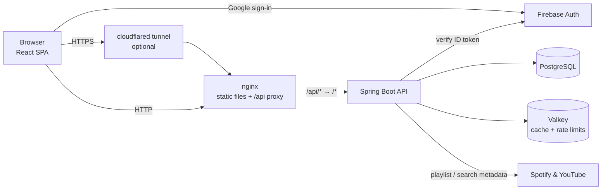

# Duely

**Tournament-style voting for songs, videos and images.** Pick a bracket, choose between two options at a time until one champion is left, then see how your picks compare with everyone else's.

[](https://github.com/haji5/duely/actions/workflows/docker-image.yml)


[](LICENSE)


<table>
  <tr>
    <td width="50%"></td>
    <td width="50%"></td>
  </tr>
  <tr>
    <td align="center"><b>Battle</b>: pick a winner, round by round</td>
    <td align="center"><b>Results</b>: server-calculated global rankings and comments</td>
  </tr>
</table>

<p align="center">
  <br>
  <b>Bracket builder</b>: paste links or import a whole Spotify playlist
</p>

---

## What it does

- **Head-to-head battles.** A bracket's items are shuffled into an elimination tournament. Choose a bracket size (a power of two): smaller sizes play a random subset, larger ones fill the spare slots with byes, and every bye is paired with a real entry so nobody skips more than one round.
- **Rich media.** Songs play inline, YouTube videos embed with thumbnails and Spotify tracks use Spotify's player. Image items show full-size previews.
- **Build your own brackets.** Paste YouTube or Spotify links and titles fill in automatically. You can also **import a whole Spotify playlist**, and each track is matched to an embeddable YouTube video.
- **Community rankings.** Every finished battle is saved. The results page shows your individual battles, your personal averages and the global leaderboard (normalised finishing position plus real head-to-head win rates), plus optional names and comments.
- **Guests welcome.** Anyone can play and submit results without an account; a guest's own runs are kept for the browser tab. Signing in with Google lets you create brackets and keeps your history across devices.
- **Host it for friends.** One script serves the app to your local network or puts it on the internet through a Cloudflare tunnel.
- Light and dark themes, a responsive layout down to phone width, and keyboard-friendly battles.

## Engineering highlights

| Area | What's interesting |
| --- | --- |
| **Ranking engine** | Rankings are incremental aggregates: each submitted run updates an `item_stats` row per item in the same transaction as the result, so the leaderboard is one indexed query of at most 500 rows, however many people have played. The score is the normalised finishing position (1 = champion, 0 = last), so runs of different sizes compare fairly, and the win rate counts only matches that were actually played. |
| **Caching** | Spring Cache is backed by Valkey (a Redis-compatible store) with absolute per-cache TTLs. Each write evicts exactly the keys it changes (a run evicts that bracket's rankings and comments and the player's history). If Valkey goes down, commands fail fast and requests are served from Postgres; the backend also starts without it. API responses are never cached by browsers (`Cache-Control: no-store`), so a result shows up immediately; the frontend keeps a small in-memory cache that writes invalidate explicitly. |
| **Auth & security** | A filter checks the Firebase ID token in the `Authorization: Bearer` header and maps custom claims to Spring Security roles. Browsers never attach that header to cross-site requests on their own, so there is no ambient credential for a CSRF attack to ride on and no CSRF token is needed. User text is stored as plain text (Jsoup strips markup) and is always rendered as text. Media URLs must be public `https` links (private, loopback, link-local and cloud-metadata addresses are rejected after DNS resolution), cache deserialization only accepts known classes, and nginx sends a strict content security policy. |
| **Abuse protection** | Fixed-window rate limits live in Valkey (an atomic `INCR`/`EXPIRE` script), so they are shared by every backend instance and their memory is bounded. Reads are limited per IP, result submissions per user (or per IP for guests), bracket creation and metadata lookups per user; a 429 carries `Retry-After`. Duplicate submissions (double clicks, retries) are idempotent on a client-generated token. |
| **Data integrity** | Liquibase owns the schema and Hibernate only validates it. A bracket and all its entries are created in one transaction. The server checks that a submitted run is a real single-elimination tournament: every ranked item belongs to the bracket, every item but the champion loses exactly once, and no pair meets twice. |
| **Delivery** | Multi-stage Docker builds run as non-root users, with health-gated startup and restart policies in Compose. nginx serves the single-page app and proxies `/api`. GitHub Actions runs the backend and frontend test suites, then builds both images and publishes them to GitHub Container Registry. |

## Architecture



The backend's routes have no `/api` prefix. nginx in Docker and the Vite dev server locally both strip it before forwarding requests.

## Tech stack

| Layer | Technologies |
| --- | --- |
| Frontend | React 19, TypeScript, Vite 7, Tailwind CSS 4, Framer Motion, React Router 7, Axios, Firebase JS SDK, Vitest |
| Backend | Java 21, Spring Boot 4.1 (Web MVC, Security, Data JPA, Data Redis, Validation, Cache, Actuator), Firebase Admin SDK, Jsoup, JUnit 5, Testcontainers |
| Data | PostgreSQL 15, Liquibase, Valkey 8 |
| Infrastructure | Docker, Docker Compose, nginx, Cloudflare Tunnel, GitHub Actions, GitHub Container Registry |

## Getting started

### Prerequisites

- [Docker Desktop](https://www.docker.com/products/docker-desktop/) (or Docker Engine with Compose)
- A [Firebase](https://console.firebase.google.com) project with **Google** sign-in enabled
- For running without Docker: Node.js 22 (see `frontend/.nvmrc`), JDK 21 and Maven 3.9

### 1. Configure Firebase

1. In the Firebase Console, add a **Web app** and copy its config values.
2. Under **Project settings → Service accounts**, click **Generate new private key** and download the JSON file.

### 2. Create the environment files

```bash
cp .env.example .env
cp backend/.env.example backend/.env
```

- In `.env`, fill in the `VITE_FIREBASE_*` values and pick a database password.
- In `backend/.env`, set `FIREBASE_CREDENTIALS_JSON` to the service-account JSON, base64-encoded (Compose env files can't hold multi-line values, so raw JSON only works squeezed onto one line). On Windows:

  ```powershell
  [Convert]::ToBase64String([IO.File]::ReadAllBytes("C:\path\to\serviceAccountKey.json")) | Set-Clipboard
  ```

### 3. Run with Docker Compose

```bash
docker compose up --build
```

| Service | URL |
| --- | --- |
| App | http://localhost:3000 |
| API (through nginx) | http://localhost:3000/api/brackets |
| Backend health | http://localhost:8080/actuator/health (readiness: `/actuator/health/readiness`) |

Postgres, Valkey and the backend are bound to `127.0.0.1` only (set `BACKEND_HOST_PORT` to publish the backend elsewhere; inside Docker it always listens on 8080). Other devices reach the app through nginx on port 3000. The backend waits for Postgres and Valkey to be healthy, and the frontend waits for the backend.

### Share it with friends (Windows)

```powershell
.\host.ps1 start            # same Wi-Fi: prints http://<your-lan-ip>:3000
.\host.ps1 start -Internet  # public HTTPS URL through a Cloudflare quick tunnel
.\host.ps1 status
.\host.ps1 stop
```

The script finds the LAN IP of the adapter holding your default route, starts the stack and waits until it's healthy. In LAN mode it also opens port 3000 in Windows Firewall for private networks (when run as Administrator). In Internet mode no firewall change is needed; nginx passes the tunnel's `https` scheme to the backend, so requests through the tunnel are same-origin. For Google sign-in on the tunnel URL, add its host name under **Firebase Console → Authentication → Settings → Authorized domains** (raw LAN IPs generally can't be authorized). Guests can play without signing in either way.

Under Docker Desktop every LAN device reaches nginx through the same gateway address, so LAN guests share one per-IP rate-limit bucket; the guest limits are sized for that.

### Local development without Docker

Start PostgreSQL (database `bracket_battle`) and Valkey or Redis on their default ports. The easiest way is to run only those containers:

```bash
docker compose up postgres valkey
```

**Backend** (Spring Boot doesn't read `.env` files, so export the variables from `backend/.env.example`):

```bash
cd backend
export DB_PASSWORD=change_me FIREBASE_CREDENTIALS_JSON="$(base64 -w0 /path/to/serviceAccountKey.json)"
mvn spring-boot:run
```

**Frontend** (the Vite dev server proxies `/api` to `localhost:8080`):

```bash
cd frontend
cp .env.example .env.local   # fill in the VITE_FIREBASE_* values
npm install
npm run dev                  # http://localhost:3000
```

## Configuration

| Variable | Where | Purpose |
| --- | --- | --- |
| `DB_URL`, `DB_USERNAME`, `DB_PASSWORD` | `.env` | PostgreSQL connection |
| `VALKEY_HOST`, `VALKEY_PORT`, `VALKEY_PASSWORD` | backend env | Cache connection (default `localhost:6379`) |
| `CORS_ALLOWED_ORIGINS` | `.env` | Comma-separated origins allowed to call the API cross-origin (pages served by nginx are same-origin and need no entry) |
| `BACKEND_HOST_PORT` | `.env` | Host port for the backend on `127.0.0.1` (default 8080) |
| `FIREBASE_CREDENTIALS_JSON` / `GOOGLE_APPLICATION_CREDENTIALS` | `backend/.env` | Firebase Admin service account (JSON, base64 JSON, or a file path) |
| `VITE_FIREBASE_*` | `.env` / `frontend/.env.local` | Firebase web app config, built into the frontend bundle |
| `VITE_API_URL` | frontend | API base URL (default `/api`) |
| `READ_RATE_LIMIT`, `RESULT_USER_RATE_LIMIT`, `RESULT_IP_RATE_LIMIT`, `BRACKET_CREATION_LIMIT`, `METADATA_SEARCH_LIMIT`, `METADATA_PLAYLIST_LIMIT` | backend env | Rate limits. Defaults: 300 reads/min per IP, 5 runs/min per user and 10/min per guest IP, 10 brackets/hour, 600 YouTube searches and 30 playlist imports per hour per user. Any `app.rate-limit.buckets.*` property can be overridden. |

Grant admin access by setting a Firebase custom claim of `{"admin": true}` or `{"role": "ADMIN"}` on a user.

## API reference

All routes are served under `/api` by the proxy.

| Method | Route | Auth | Description |
| --- | --- | --- | --- |
| GET | `/brackets` | – | Playable brackets (2+ entries), newest first |
| GET | `/brackets/popular` | – | Playable brackets, most played first |
| GET | `/brackets/{id}` | – | One bracket |
| GET | `/brackets/{id}/items` | – | Entries in a bracket |
| GET | `/brackets/{id}/rankings` | – | Global leaderboard |
| GET | `/brackets/{id}/comments` | – | Newest 50 comments (no user ids) |
| POST | `/brackets/{id}/results` | optional | Submit a run: ranking plus the real matches; idempotent per submission token (409 if the token belongs to someone else) |
| POST | `/brackets` | user | Create a bracket together with its 2–500 entries |
| GET | `/me/brackets` | user | Brackets you created |
| GET | `/me/results?bracketId=` | user | Your runs, optionally for one bracket |
| GET | `/metadata/spotify/playlist?url=` | user | Tracks from a public Spotify playlist |
| GET | `/metadata/youtube/search?query=` | user | First embeddable YouTube match |
| POST | `/admin/cache/clear[/{name}]` | admin | Clear all caches or one |
| GET | `/actuator/health`, `/actuator/info` | – | Health (direct to the backend only; nginx doesn't proxy `/api/actuator`) |

Errors are JSON: `{timestamp, status, error, message, errors?}`, where `errors` maps fields such as `items[2].mediaUrl` to messages.

## Project structure

```
duely/
├── backend/                         Spring Boot API
│   └── src/main/
│       ├── java/com/bracketbattle/
│       │   ├── controller/          REST endpoints (brackets, metadata, admin cache)
│       │   ├── service/             Bracket creation, run validation, cache eviction
│       │   ├── security/            Firebase token filter, security config
│       │   ├── ratelimit/           Valkey fixed-window rate limiter
│       │   ├── media/               Media URL validation, YouTube/Spotify metadata
│       │   ├── config/              Cache and web config
│       │   ├── model/ dto/ repository/   (item_stats aggregates in ItemStatsRepository)
│       │   └── util/Sanitizer.java  Jsoup-based input cleaning
│       └── resources/
│           ├── application.properties
│           └── db/changelog/        Liquibase migrations
├── frontend/                        React single-page app
│   ├── src/
│   │   ├── pages/                   Home, Browse, Bracket (battle), Results, Create
│   │   ├── components/              Media preview, navbar, auth widgets
│   │   ├── contexts/                Auth, theme, guest session battles
│   │   ├── services/                Axios client, oEmbed title lookups
│   │   └── utils/                   Tournament engine, rankings, API cache, media URL helpers
│   ├── nginx.conf                   Production server and /api proxy
│   └── security-headers.conf        Headers shared by every nginx location
├── docs/screenshots/                README images
├── .github/workflows/               CI: tests, then build and publish Docker images
├── docker-compose.yml               Full stack
├── docker-compose.local.yml         LAN / tunnel overlay used by host.ps1
└── host.ps1                         One-command hosting script
```

## Testing

```bash
cd backend && mvn verify      # unit tests, then integration tests (needs Docker running)
cd frontend && npm run typecheck && npm test && npm run build
```

- **Backend:** JUnit 5 unit tests (media URL validation, sanitizer, ranking maths, rate-limit windows, run validation) run in `mvn test`. Integration tests (`*IT`) start Postgres and Valkey with Testcontainers and drive the API through MockMvc with a mocked `FirebaseAuth`: creation, submissions and idempotency, rankings after several runs, comments, `/me` endpoints, error statuses, admin access, rate limits with `Retry-After`, cache round-trips through real Valkey, the Liquibase backfill, and startup with Valkey down.
- **Frontend:** Vitest covers the tournament engine (every entry count from 2 to 20 at every size), the ranking formula, media URL rules, and regression tests for the Browse filters and the bracket builder's title autofill.
- CI runs both suites (plus `npm audit --omit=dev`) before any image is built.

`frontend/package.json` overrides `@grpc/grpc-js`: Firebase's Firestore package still pins a vulnerable 1.9.x release. Duely doesn't use Firestore (and gRPC never runs in the browser), so the override only keeps `npm audit` clean.

## Roadmap

- Paging for `/brackets` once there are tens of thousands of brackets
- Bracket editing and deletion for owners

## License

© Tobias Richardson. Licensed under the [PolyForm Noncommercial License 1.0.0](LICENSE).

You're free to use, modify and share this code for personal projects, study, research, hobby use and other noncommercial purposes. Commercial use, including selling the code or a product or service built on it, isn't permitted. For a commercial license, [get in touch](https://github.com/haji5).
