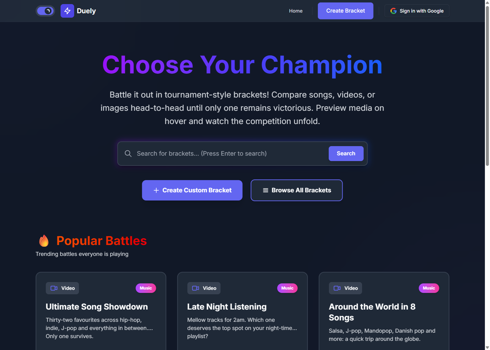
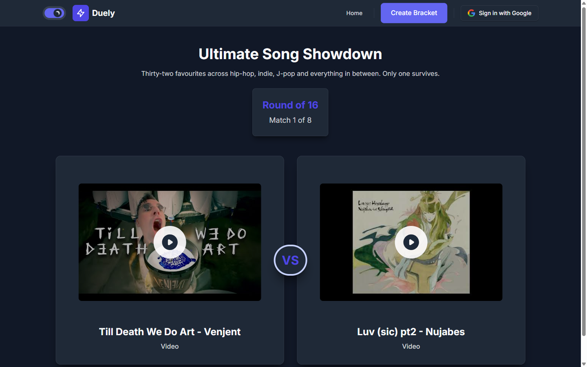
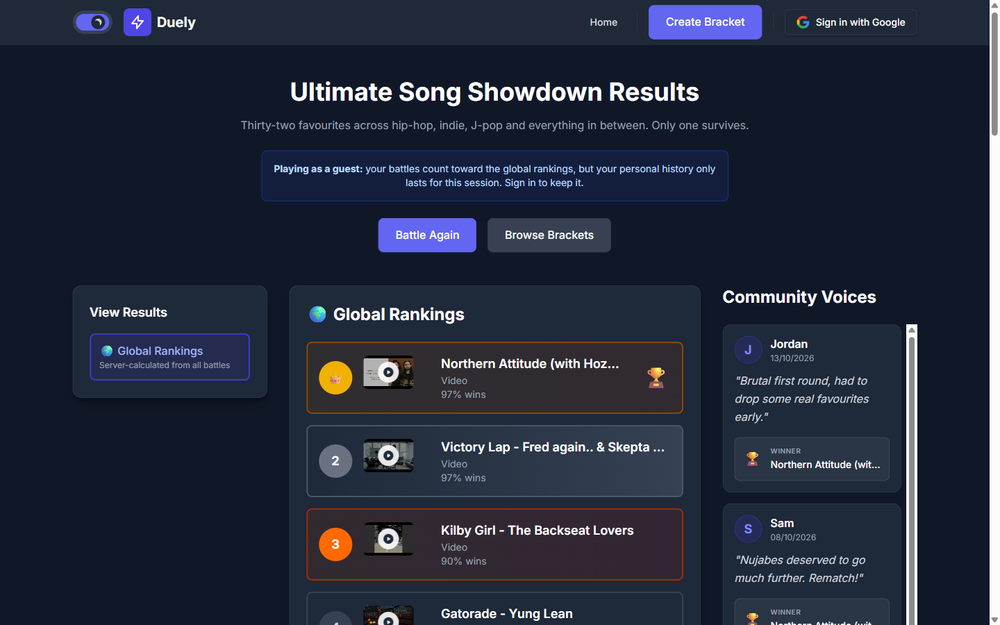
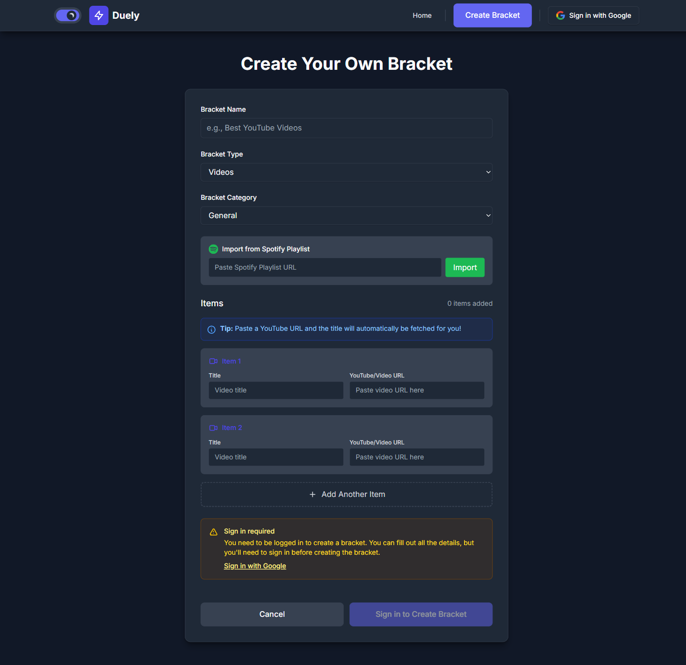
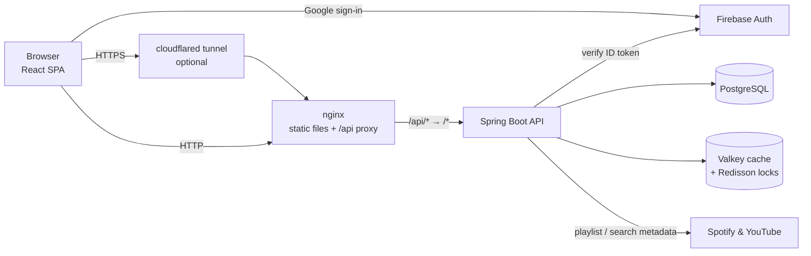

# Duely

**Tournament-style voting for songs, videos and images.** Pick a bracket, choose between two options at a time until one champion is left, then see how your picks compare with everyone else's.

[](https://github.com/haji5/duely/actions/workflows/docker-image.yml)




<table>
  <tr>
    <td width="50%"></td>
    <td width="50%"></td>
  </tr>
  <tr>
    <td align="center"><b>Battle</b>: pick a winner, round by round</td>
    <td align="center"><b>Results</b>: server-calculated global rankings and comments</td>
  </tr>
</table>

<p align="center">
  <br>
  <b>Bracket builder</b>: paste links or import a whole Spotify playlist
</p>

---

## What it does

- **Head-to-head battles.** A bracket's items are shuffled into an elimination tournament. Choose a bracket size (a power of two) and any missing slots are filled with byes automatically.
- **Rich media.** Songs play inline, YouTube videos embed with thumbnails and Spotify tracks use Spotify's player. Image items show full-size previews.
- **Build your own brackets.** Paste YouTube or Spotify links and titles fill in automatically. You can also **import a whole Spotify playlist**, and each track is matched to an embeddable YouTube video.
- **Community rankings.** Every finished battle is saved. The results page shows your individual battles, your personal averages and the global leaderboard, plus optional names and comments.
- **Guests welcome.** Anyone can play and submit results without an account. Signing in with Google lets you create brackets and keeps your history across devices.
- **Host it for friends.** One script serves the app to your local network or puts it on the internet through a Cloudflare tunnel.
- Dark mode, responsive layout and Framer Motion animations.

## Engineering highlights

| Area | What's interesting |
| --- | --- |
| **Ranking engine** | Rankings are calculated on the server from every submitted result. Each item gets a position score (a Borda-style average) and a head-to-head win rate. Results are cached in Valkey, and a Redisson distributed lock stops many simultaneous requests from recalculating the same bracket at once. |
| **Caching** | Spring Cache is backed by Valkey (a Redis-compatible store), with a separate time-to-live for each cache. Writes clear only the affected entries, for example one bracket's results and rankings. If Valkey is down, the app still serves data from the database. The frontend also keeps a small in-memory cache with least-recently-used eviction. |
| **Auth & security** | A servlet filter checks the Firebase ID token on each request and maps custom claims to Spring Security roles. Writes are protected with double-submit CSRF tokens, and user text is cleaned with Jsoup. The metadata proxy only allows Spotify and YouTube URLs, which blocks server-side request forgery (SSRF), and cache deserialization only accepts known classes. Responses carry strict security headers, including a content security policy. |
| **Abuse protection** | Resilience4j rate limits apply per user, or per IP address for guests: bracket creation, item additions, result submissions and all reads each have their own limit. Duplicate submissions (double clicks, retries) are detected with a submission token. |
| **Data integrity** | The schema is managed by Liquibase migrations, and Hibernate only validates it (`ddl-auto=validate`). The server rejects rankings that repeat an item or include items from another bracket. |
| **Delivery** | Multi-stage Docker builds run as non-root users. nginx serves the single-page app and proxies `/api`. GitHub Actions builds both images and publishes them to GitHub Container Registry. |

## Architecture



The backend's routes have no `/api` prefix. nginx in Docker and the Vite dev server locally both strip it before forwarding requests.

## Tech stack

| Layer | Technologies |
| --- | --- |
| Frontend | React 19, TypeScript, Vite 7, Tailwind CSS 4, Framer Motion, React Router 7, Axios, Firebase JS SDK |
| Backend | Java 21, Spring Boot 3.3 (Web, Security, Data JPA, Validation, Cache, Actuator), Firebase Admin SDK, Resilience4j, Redisson, Jsoup |
| Data | PostgreSQL 15, Liquibase, Valkey 8 |
| Infrastructure | Docker, Docker Compose, nginx, Cloudflare Tunnel, GitHub Actions, GitHub Container Registry |

## Getting started

### Prerequisites

- [Docker Desktop](https://www.docker.com/products/docker-desktop/) (or Docker Engine with Compose)
- A [Firebase](https://console.firebase.google.com) project with **Google** sign-in enabled
- For running without Docker: Node.js 22 (see `frontend/.nvmrc`), JDK 21 and Maven 3.9

### 1. Configure Firebase

1. In the Firebase Console, add a **Web app** and copy its config values.
2. Under **Project settings → Service accounts**, click **Generate new private key** and download the JSON file.

### 2. Create the environment files

```bash
cp .env.example .env
cp backend/.env.example backend/.env
```

- In `.env`, fill in the `VITE_FIREBASE_*` values and pick a database password.
- In `backend/.env`, set `FIREBASE_CREDENTIALS_JSON` to the service-account JSON, either raw or base64-encoded. On Windows:

  ```powershell
  [Convert]::ToBase64String([IO.File]::ReadAllBytes("C:\path\to\serviceAccountKey.json")) | Set-Clipboard
  ```

### 3. Run with Docker Compose

```bash
docker compose up --build
```

| Service | URL |
| --- | --- |
| App | http://localhost:3000 |
| API (through nginx) | http://localhost:3000/api/brackets |
| Backend health | http://localhost:8080/actuator/health |

Postgres, Valkey and the backend are bound to `127.0.0.1` only. Other devices reach the app through nginx on port 3000.

### Share it with friends (Windows)

```powershell
.\host.ps1 start            # same Wi-Fi: prints http://<your-lan-ip>:3000
.\host.ps1 start -Internet  # public HTTPS URL through a Cloudflare quick tunnel
.\host.ps1 status
.\host.ps1 stop
```

The script finds your LAN IP, sets CORS, starts the stack and (when run as Administrator) opens port 3000 in Windows Firewall. For Google sign-in to work on the shared URL, add its domain under **Firebase Console → Authentication → Settings → Authorized domains**. Guests can play without signing in either way.

### Local development without Docker

Start PostgreSQL (database `bracket_battle`) and Valkey or Redis on their default ports. The easiest way is to run only those containers:

```bash
docker compose up postgres valkey
```

**Backend** (Spring Boot doesn't read `.env` files, so export the variables from `backend/.env.example`):

```bash
cd backend
export DB_PASSWORD=change_me FIREBASE_CREDENTIALS_JSON="$(cat /path/to/serviceAccountKey.json)"
mvn spring-boot:run
```

**Frontend** (the Vite dev server proxies `/api` to `localhost:8080`):

```bash
cd frontend
cp .env.example .env.local   # fill in the VITE_FIREBASE_* values
npm install
npm run dev                  # http://localhost:3000
```

## Configuration

| Variable | Where | Purpose |
| --- | --- | --- |
| `DB_URL`, `DB_USERNAME`, `DB_PASSWORD` | `.env` | PostgreSQL connection |
| `VALKEY_HOST`, `VALKEY_PORT`, `VALKEY_PASSWORD` | backend env | Cache connection (default `localhost:6379`) |
| `CORS_ALLOWED_ORIGINS` | `.env` | Comma-separated origins allowed to call the API directly |
| `FIREBASE_CREDENTIALS_JSON` / `GOOGLE_APPLICATION_CREDENTIALS` | `backend/.env` | Firebase Admin service account (JSON, base64 JSON, or a file path) |
| `VITE_FIREBASE_*` | `.env` / `frontend/.env.local` | Firebase web app config, built into the frontend bundle |
| `VITE_API_URL` | frontend | API base URL (default `/api`) |
| `READ_RATE_LIMIT`, `BRACKET_CREATION_LIMIT`, `ITEM_CREATION_LIMIT` (and `*_REFRESH_PERIOD`) | backend env | Rate-limit tuning; defaults are 100 reads/min per IP, 10 brackets/hour and 200 items/hour per user |

Grant admin access by setting a Firebase custom claim of `{"admin": true}` or `{"role": "ADMIN"}` on a user.

## API reference

All routes are served under `/api` by the proxy.

| Method | Route | Auth | Description |
| --- | --- | --- | --- |
| GET | `/brackets` | – | All brackets |
| GET | `/brackets/popular` | – | Brackets ordered by number of results |
| GET | `/brackets/{id}` | – | One bracket |
| GET | `/brackets/{id}/items` | – | Items in a bracket |
| GET | `/brackets/{id}/results` | – | All submitted results |
| GET | `/brackets/{id}/rankings` | – | Aggregated global ranking |
| POST | `/brackets` | user | Create a bracket |
| POST | `/brackets/{id}/items` | owner | Add one item |
| POST | `/brackets/{id}/items/bulk` | owner | Add up to 500 items |
| POST | `/brackets/{id}/results` | optional | Submit a ranking (rate-limited, idempotent per submission token) |
| GET | `/brackets/by-creator/{uid}` | self | Brackets you created |
| GET | `/users/{uid}/results` | self | Your results |
| GET | `/brackets/{id}/users/{uid}/results` | self | Your results for one bracket |
| GET | `/metadata/spotify/playlist?url=` | – | Tracks from a public Spotify playlist |
| GET | `/metadata/youtube/search?query=` | – | First embeddable YouTube match |
| GET | `/csrf-token` | user | Issue a CSRF token (required for authenticated writes) |
| GET / POST | `/admin/cache/info`, `/admin/cache/clear[/{name}]` | admin | Inspect and clear caches |
| GET | `/actuator/health` | – | Database and Valkey health |

## Project structure

```
duely/
├── backend/                         Spring Boot API
│   └── src/main/
│       ├── java/com/bracketbattle/
│       │   ├── controller/          REST endpoints (brackets, metadata, CSRF, admin cache)
│       │   ├── service/             Business logic, ranking calculation, cache eviction
│       │   ├── security/            Firebase token filter, CSRF filter, security config
│       │   ├── config/              Cache, rate limiting, Redisson, web config
│       │   ├── model/ dto/ repository/
│       │   └── util/Sanitizer.java  Jsoup-based input cleaning
│       └── resources/
│           ├── application.properties
│           └── db/changelog/        Liquibase migrations
├── frontend/                        React single-page app
│   ├── src/
│   │   ├── pages/                   Home, Browse, Bracket (battle), Results, Create
│   │   ├── components/              Media preview, navbar, auth widgets
│   │   ├── contexts/                Auth, theme, guest session battles
│   │   ├── services/                Axios client and CSRF handling
│   │   └── utils/                   API cache, media URL helpers
│   └── nginx.conf                   Production server and /api proxy
├── docs/screenshots/                README images
├── .github/workflows/               CI: build and publish Docker images
├── docker-compose.yml               Full stack
├── docker-compose.local.yml         LAN / tunnel overlay used by host.ps1
└── host.ps1                         One-command hosting script
```

## Development checks

```bash
cd frontend && npm run build   # TypeScript type-check plus production build
cd backend  && mvn verify      # compile and package
```

Vitest and Testing Library are set up in the frontend (`npm test`), and `spring-boot-starter-test` is included in the backend.

## Roadmap

- Automated tests for the tournament engine, ranking calculation and security rules
- Shared rate-limit and CSRF state (move both into Valkey) for running several backend instances
- Bracket editing and deletion for owners

## License

[MIT](LICENSE) © Tobias Richardson
